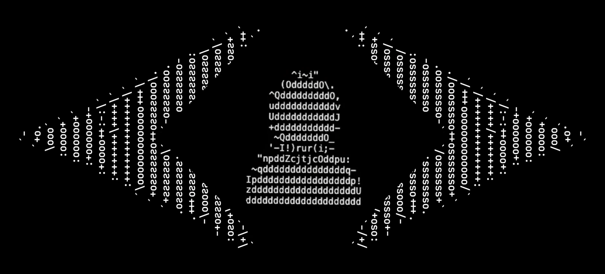

# VeriFi

<p align="center"></p>

**natHacks 2026 · Security & Defense track**

VeriFi helps an interviewer notice when the person they're questioning reacts. It watches heart rate, breathing, blinks, face and voice while the subject answers normally, compares every answer with that person's own calm baseline, and points to the questions worth following up. **It doesn't decide who is lying; the investigator does.**

---

## The problem

An investigator running an interview has to ask questions, listen, take notes and read body language all at once, so reactions slip past them. The tool built for this, the polygraph, gives a verdict, and that's a big part of why it has been inadmissible in Canadian courts since 1987. VeriFi measures and explains reactions instead of judging them.

## How a session runs

```text
  BASELINE         60 s, silent and still     ->  this person's calm heart rate, breathing, blinks, face
  VOICE BASELINE   25 s, reads 5 neutral       ->  how this person sounds (and breathes) while talking
                   sentences aloud
  ┌─> ASK          investigator clicks Ask, then Done asking when the question ends
  │   ANSWER       subject answers; scored from Ask until 10 s after Done asking
  │   READING      deception likelihood + 80% range + "Why this reading"
  └── next question
  STOP             every question ranked, so the investigator knows where to dig
```

What the investigator sees:

- **Live signals and a combined stress indicator**, each drawn against the person's normal range.
- **A deception likelihood for every answer**, from Low to High, with an 80% range. It updates live while the answer is still coming in.
- **"Why this reading"**: which signal groups pushed the score up or down, how this answer compares with the person's calm moments, and the raw signals around the question.
- **"Not enough signal"** when an answer can't be scored reliably, for example after a sensor dropout, instead of a misleading number.
- **Every question ranked at the end** by the size of the body's response (spike), alongside each answer's likelihood.

## What it measures

| Signal group | Sensor | What VeriFi looks at | Weight in the answer score |
|---|---|---|---|
| Breathing | BioAmp EMG on the chest, via Arduino | Breath events → breathing rate; slower breathing counts. Breath holds count in the live stress indicator | 0.20 |
| Heart rate | BioAmp ECG, via Arduino | Change from the 5 s just before the question | 0.15 |
| Voice | Laptop mic + Parselmouth | Pitch, loudness, spectral slope, voice clarity (HNR), jitter, shimmer, compared with the read-aloud baseline. Per-answer response time, speech rate and pauses are shown, not scored | 0.13 |
| Blinks | Webcam + MediaPipe Face Landmarker | Blink rate (eye aspect ratio, per-person thresholds) | 0.12 |
| Lips and hands | Webcam + MediaPipe | Lip compression, hand on face | 0.05 |
| Skin conductance | GSR sensor (CJMCU-6701) | **Not used.** Ours read too steadily to trust, so the dashboard shows it as *Simulated* with no weight | 0 |

Weights follow how strong the published evidence is for each cue. Face cues get low weight on purpose (see [What didn't work](#what-didnt-work)).

## How the score works

1. **Against this person, not a population.** Every signal is compared with how *this* subject behaved during their own baseline. Voice and breathing are compared with the read-aloud baseline, because talking changes both.
2. **Calibrated so calm reads as calm.** VeriFi scores many "pseudo-questions" across the calm baseline to learn what a nothing-happened answer looks like for this person, and measures each real answer against that. Heart rate is compared with the seconds just before each question, so slow drift over a session isn't mistaken for a reaction.
3. **Combined into a likelihood.** The signal groups are combined (weighted Stouffer) into one score, then into a deception likelihood with an 80% range: Low (<30%), Unclear, Elevated (≥60%), High (≥85%).
4. **Quality gates.** If sensors dropped out during the answer, or fewer than two signal groups are usable, the answer shows **Not enough signal** with the reason.

The math, constants and message formats are in [docs/TECHNICAL.md](docs/TECHNICAL.md).

## Results

### Simulated interview sessions

To check that the scoring behaves as designed, we ran simulated sessions through VeriFi's real scoring code (`python -m backend.simulate`). Each session has the 60 s baseline, the 25 s voice baseline and 6 questions; one random question gets a stress reaction and the other five are calm. The signals have realistic noise: wandering heart rate, irregular breathing, noisy blinks and voice. 100 sessions per condition:

| Reaction on one question | Flagged (Elevated or High) | Highest likelihood of the 6 questions (chance: 17%) |
|---|---|---|
| Combined moderate: heart rate +6 bpm, a 9 s breath hold, pitch +10 Hz | **89%** | **96%** |
| Heart rate +10 bpm | 91% | 99% |
| Heart rate +5 bpm | 37% | 65% |
| Blink rate −8/min | 57% | 77% |
| Voice pitch +15 Hz | 35% | 64% |
| Hand on face | 22% | 57% |
| Breath hold alone, about 9 s | 5% | 24% |
| **Calm answers wrongly flagged** | **2.8%** of about 4,600 | n/a |
| Answers with a 3 s sensor dropout | 100% shown as "Not enough signal" | n/a |

Each answer is scored in about 5 ms.

These numbers come from synthetic data, with a noise model we chose. They show the scoring does what it's designed to do: it rarely flags calm answers and catches clear reactions. **They are not an accuracy figure on real people.**

### Blink detection on a live webcam

A team member followed timed prompts in front of a MacBook webcam and counted their own blinks:

| Step | Counted | Detected |
|---|---|---|
| Facing the camera, 30 s | 15–17 | 18 |
| Looking to the side, 20 s | about 16–18 | 18 |

Hand-over-mouth and pressed lips were picked up in both prompted attempts each, and no hand was detected while the hands were down. That's one person and one run.

### What didn't work

Our first version scored **face cues alone** (blinks, lip compression, hand-to-face, gaze, head motion) in a card test. It was no better than chance: across 6 runs the real card ranked 3, 1, 2, 5, 1 and 4 out of 5. So face cues now carry little weight, and the score leans on signals with stronger evidence. Running a test that could prove us wrong was one of the most useful results of the weekend.

### Identity recognition test (separate tool)

The CV team also built a reaction-time recognition test (`openCV/`, about 10 minutes, keyboard only), meant to run **before** an interview. The subject presses NO to every word shown, including their own name, hometown and mother's name. Recognizing a word slows that NO by a few hundredths of a second. In our pilot it detected real personal details in **3 of 4 runs** (p ≤ .001), and the **one control run** with a made-up identity was not flagged. That's a pilot, not an accuracy claim. Details are in [openCV/README.md](openCV/README.md).

## Limitations and responsible use

- **Stress is not lying.** An innocent person can react to an emotional or accusatory question, and a calm liar may not react at all. VeriFi flags moments to follow up on; it never gives a verdict.
- **Not validated on people yet.** The scoring has been checked on simulated sessions and live sensor tests, not on a group of real subjects with known ground truth. The constants haven't been tuned on real sessions.
- **Breath holds are weak.** In simulation, a single held breath was flagged only 5% of the time, because breathing is estimated from breath events smoothed over 30 s.
- **No skin conductance.** Usually the strongest stress signal, but our sensor wasn't usable, so VeriFi relies on the remaining signals.
- **Camera placement matters.** Blinks aren't counted while the head is turned more than 35° or tilted more than 25°, so the camera should sit at eye level, where the subject will be looking.
- **Short answers work best.** Talking shifts breathing and heart rate. VeriFi accounts for this with the read-aloud baseline, but yes/no or few-word answers are cleanest.
- **Compare questions within one session, not across people.** Every number is relative to that person's own baseline.
- **Prototype only.** Not for real investigations, hiring, or any decision about a person.

## Run it

You need Python 3, Node.js 20.19+ or 22.12+, and a webcam and mic. The Arduino is optional: without it, `--fake-body` simulates the body sensors.

```bash
git clone https://github.com/V3riFi/VeriFi.git
cd VeriFi
python3 -m venv .venv && source .venv/bin/activate     # Windows: .venv\Scripts\activate
pip install -r requirements.txt
python3 openCV/download_models.py                      # face models, once

python3 run.py --fake-body   # no Arduino: fake heart rate and breathing, real camera and mic
python3 run.py               # with the Arduino plugged in and flashed (see docs/TECHNICAL.md)
```

`run.py` installs the dashboard's packages on first use, starts the backend and dashboard, and opens the browser. For a 10 s baseline while trying it out, use `VERIFI_BASELINE_S=10 python3 run.py --fake-body`. On a Mac, the terminal needs camera and microphone permission. Press **Ctrl+C** to stop.

## Architecture

```text
   ECG · EMG (chest)        Webcam             Mic
          │                    │                │
     Arduino UNO               │                │
   115200 baud · 10 Hz         │                │
          │                    │                │
   ┌──────▼────────────────────▼────────────────▼─────────────────┐
   │  PYTHON BACKEND: one process, one clock                      │
   │  inputs   serial_io.py · camera.py · voice/live.py           │
   │  vision   face.py (MediaPipe on camera frames)               │
   │  scoring  scoring.py: baseline, live stress                  │
   │           confidence.py + verdict.py: per-answer likelihood  │
   │  output   server.py: session timing, CSV + WAV logging       │
   └─────────────────────────────┬────────────────────────────────┘
                                 │ WebSocket JSON, ~20 updates/s + video
   ┌─────────────────────────────▼────────────────────────────────┐
   │  DASHBOARD: React + uPlot                                    │
   │  live charts · stress · per-answer likelihood                │
   │  "Why this reading" · question ranking                       │
   └──────────────────────────────────────────────────────────────┘
```

| Layer | Tech |
|---|---|
| Firmware | Arduino C++ on an Arduino UNO: ECG beat detection (5–20 Hz band-pass, adaptive threshold) and breath events |
| Backend | Python, FastAPI + uvicorn, one process so every signal shares one clock |
| Vision | OpenCV + MediaPipe Face Landmarker and Hand Landmarker (Tasks API) |
| Voice | sounddevice + Parselmouth (Praat) |
| Scoring | numpy, no model training: every score is relative to the person's own baseline |
| Dashboard | Vite + React + uPlot over WebSockets |
| Storage | One CSV and WAV per session in `data/` (not committed) |

Everything runs locally on one laptop. No cloud.

## Team

| Name | Area |
|---|---|
| Aaryan | frontend |
| Matthew | Tech lead|
| Aagrim | openCV |
| Cohen | hardware, firmware |
| Zhenjie Wang | Parselmouth |
| Namish | product manager |

## For developers

[docs/TECHNICAL.md](docs/TECHNICAL.md) has the full setup, the WebSocket contract (message formats), scoring definitions and constants, hardware wiring, the serial protocol and troubleshooting. Code comments that say "see README" refer to that file. Contribution rules are in [CONTRIBUTING.md](CONTRIBUTING.md).

## Sources

Skin, breathing, heart (top weights)
Meijer et al. (2014), CIT meta-analysis of skin conductance, respiration, heart rate and P300: https://doi.org/10.1111/psyp.12239
Ben-Shakhar & Elaad (2003), Guilty Knowledge Test meta-analysis: https://doi.org/10.1037/0021-9010.88.1.131
Lykken (1959), The GSR in the detection of guilt: https://doi.org/10.1037/h0046060
National Research Council (2003), The Polygraph and Lie Detection (free to read): https://doi.org/10.17226/10420
Verschuere, Ben-Shakhar & Meijer (2011), Memory Detection (book): https://doi.org/10.1017/CBO9780511975196
Behavioural cues (voice, blink, lip, hand, gaze)
DePaulo et al. (2003), Cues to deception: https://doi.org/10.1037/0033-2909.129.1.74
Sporer & Schwandt (2006), Paraverbal indicators of deception: https://doi.org/10.1002/acp.1190
Sporer & Schwandt (2007), Moderators of nonverbal indicators of deception: https://doi.org/10.1037/1076-8971.13.1.1
Leal & Vrij (2008), Blinking during and after lying: https://doi.org/10.1007/s10919-008-0051-0
Fukuda (2001), Eye blinks: new indices for the detection of deception: https://doi.org/10.1016/S0167-8760(00)00192-6
Giddens et al. (2013), Vocal indices of stress: A review: https://doi.org/10.1016/j.jvoice.2012.12.010
Harnsberger et al. (2009), Stress and deception in speech (layered voice analysis): https://doi.org/10.1111/j.1556-4029.2009.01026.x
Wiseman et al. (2012), The eyes don’t have it (free to read): https://doi.org/10.1371/journal.pone.0040259
Ekman & Friesen (1969), Nonverbal leakage and clues to deception: https://doi.org/10.1080/00332747.1969.11023575
Porter & ten Brinke (2008), Reading between the lies: https://doi.org/10.1111/j.1467-9280.2008.02116.x
Mann, Vrij & Bull (2002), Suspects, lies, and videotape: https://doi.org/10.1023/A:1015332606792
Theory: why liars act differently
Zuckerman, DePaulo & Rosenthal (1981), Verbal and nonverbal communication of deception: https://doi.org/10.1016/S0065-2601(08)60369-X
Vrij, Granhag & Porter (2010), Pitfalls and opportunities in lie detection: https://doi.org/10.1177/1529100610390861
Vrij, Hartwig & Granhag (2019), Reading lies (Annual Review of Psychology): https://doi.org/10.1146/annurev-psych-010418-103135
Vrij (2008), Detecting Lies and Deceit, 2nd ed., Wiley (no DOI): https://scholar.google.com/scholar?q=Vrij+2008+Detecting+Lies+and+Deceit+Pitfalls+and+Opportunities
Why you combine signals and use a baseline
Bond & DePaulo (2006), Accuracy of deception judgments: https://doi.org/10.1207/s15327957pspr1003_2
Hartwig & Bond (2011), Why do lie-catchers fail?: https://doi.org/10.1037/a0023589
Suchotzki et al. (2017), Lying takes time: https://doi.org/10.1037/bul0000087
Meijer et al. (2016), Deception detection with behavioral, autonomic, and neural measures: https://doi.org/10.1111/psyp.12609
Lukács, Kleinberg & Verschuere (2017), Familiarity-related fillers (cited in METHOD.md): https://doi.org/10.1016/j.jarmac.2017.01.013
Math for combining them
Stouffer et al. (1949), The American Soldier, Vol. 1 (no DOI): https://scholar.google.com/scholar?q=Stouffer+1949+The+American+Soldier+Adjustment+During+Army+Life
Whitlock (2005), The weighted Z-method is superior to Fisher’s approach: https://doi.org/10.1111/j.1420-9101.2005.00917.x
Zaykin (2011), Optimally weighted Z-test: https://doi.org/10.1111/j.1420-9101.2011.02297.x
Satterthwaite (1946), An approximate distribution of estimates of variance components: https://doi.org/10.2307/3002019
